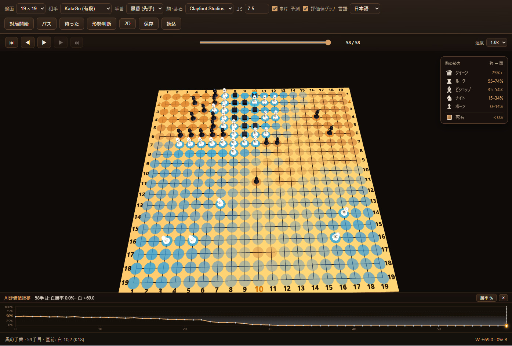

# GoGame 3D

A 3D Go game that runs in the browser (GitHub Pages / PWA) and as an Electron
desktop app. Stones are chess pieces whose rank grows from pawn to king based
on the KataGo ownership/weight estimate, and the board surface is tinted by the
predicted territory.



**Play online:** https://gadget114514.github.io/GoGame/

## Features

- **Board sizes**: 9×9, 13×13, 19×19 (selectable at runtime, defaults to 9×9).
- **AI**: KataGo neural nets converted to TensorFlow.js, bundled as static data.
  - Dan and Kyu levels.
  - 9×9/13×13 use padded inference with the 19×19 net until dedicated per-size
    models are added (drop them in `public/models/{dan,kyu}-{9,13}x{...}/`).
- **3D view** (Babylon.js): chess-piece stones (`pawn → knight → bishop → rook →
  queen → king`) driven by color-relative ownership thresholds; dead stones
  become small cubes in the chess-piece styles (traditional stones stay stones).
- **Score colorization**: per-intersection ownership heatmap on both the 3D board
  and the 2D fallback.
- **Two-eye analysis**: highlights true eyes and living false eyes, with optional
  fence/seaweed wall models and flower/weed eye models.
- **Piece styles**: Clayfoot, Dark Yagami, Animal Bag, Kenney Cube Pets, Quirky
  Animals (default), and traditional stones.
- **Config persistence**: all settings are stored together under
  `localStorage['gogame:config']` and restored on startup.
- **2D fallback** view, SGF save/load, pass, undo, evaluation.
- **PWA** (offline via service worker) and **Electron** packaging.

## Quick start

```bash
npm install
npm run dev        # http://localhost:5173
npm run build      # static build in dist/
npm run preview
npm run test       # rule + tensor + move-selection + rank unit tests
RUN_MODEL_TESTS=1 npx vitest run tests/models.integration.test.ts  # real model inference
```

### Models

The 19×19 TF.js models are committed under `public/models/`. To re-download them:

```bash
npm run fetch:models
```

Dedicated 9×9 / 13×13 nets are optional. See `scripts/models.config.json` for
source URLs; convert them to fixed-size TensorFlow.js graph models and place them
in `public/models/dan-9x9/`, `public/models/kyu-9x9/`, etc. The app auto-detects
and prefers them.

### Chess pieces

Converted GLB assets live in `public/assets/chess/`. To regenerate them:

```bash
npm run convert:fbx
node scripts/build-animal-packs.mjs   # Animal Bag / Kenney / Quirky packs
```

The script uses `C:/Users/bluen/.local/bin/FBX2glTF-windows-x64.exe` by default;
override with the `FBX2GLTF` environment variable.

## Electron

```bash
npm run electron:dev     # Vite dev server + Electron
npm run electron:build   # installers in release/
GOGAME_BUNDLE=1 npx electron .   # exercise the production app:// path from dist/
```

The production app serves `dist/` through a privileged `app://` protocol so that
`fetch()` and TensorFlow.js model loading work without a local HTTP server.

## GitHub Pages

The live site is https://gadget114514.github.io/GoGame/.

Push to `main`. `.github/workflows/deploy.yml` builds and deploys `dist/` using
GitHub's Pages actions. `vite.config.ts` uses `base: './'`, so project sites
(`https://user.github.io/repo/`) work without changes.

## Layout

```
src/game/     board-size agnostic rules (Goban, scoring, SGF)
src/ai/       KataGo TF.js engine, padded tensor encoding, model registry
src/ui/       3D (Babylon) and 2D (Canvas) renderers, controller
electron/     main + preload (app:// protocol, PWA disabled)
scripts/      model download + FBX→GLB conversion
public/       models, chess/eye/wall GLBs, icons
tests/        Vitest rule/tensor tests
```

See `doc/DESIGN.md` and `doc/DESIGN-detail.md` for the full design.
